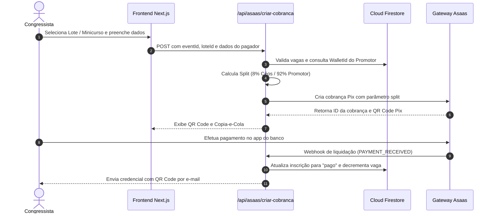

# 🏛️ Céos System — Plataforma de Gestão de Congressos & Eventos Científicos

<div align="center">


<p align="center">
  <strong>Ecossistema completo e inteligente para gestão de congressos acadêmicos, simpósios, submissões científicas, credenciamento por QR Code e pagamentos automatizados com split financeiro.</strong>
</p>

[Visão Geral](#-sobre-o-projeto) •
[Funcionalidades](#-principais-funcionalidades) •
[Arquitetura](#-arquitetura-e-tecnologias) •
[Estrutura de Pastas](#-estrutura-de-pastas) •
[Fluxos do Sistema](#-fluxos-do-sistema) •
[Instalação](#-instalação-e-execução) •
[Variáveis de Ambiente](#-variáveis-de-ambiente)

</div>

---

## 📌 Sobre o Projeto

O **Céos System** é uma solução *full-stack serverless* de alto desempenho projetada para modernizar e simplificar a realização de congressos e simpósios universitários. A plataforma conecta congressistas, comissões científicas, pareceristas e promotores em uma interface unificada, responsiva e em tempo real.

### Principais Diferenciais
- 💳 **Split de Pagamento Automático:** Divisão nativa das receitas no gateway Asaas (8% comissão Céos retida na conta-mãe / 92% creditado na subconta do organizador).
- 🔬 **Pipeline Científico Completo:** Submissão de Resumos Simples e Expandidos, avaliação duplo-cega por pareceristas, alocação de bancas presenciais e compilação de Anais.
- 🎟️ **Credenciamento Digital:** Geração de ingressos com QR Code criptografado para check-in instantâneo na portaria do evento.
- 📜 **Certificação com Autenticidade Pública:** Emissão automatizada de certificados com código verificador e validação online.
- 📱 **Interface 100% Responsiva:** Layout mobile-first otimizado para celulares, tablets e desktops.

---

## ✨ Principais Funcionalidades

### 🎓 Para Congressistas e Alunos
* **Catálogo & Busca:** Exploração de congressos, simpósios e encontros com filtros por categoria e status.
* **Inscrições Flexíveis:** Compra de lotes e minicursos avulsos via Pix (QR Code dinâmico e Copia-e-Cola) ou Cartão de Crédito.
* **Cupons de Desconto:** Aplicação de cupons percentuais ou de cortesia total (inscrição direta a R$ 0,00).
* **Área do Participante:** Acompanhamento de pedidos, download de ingressos com QR Code e histórico financeiro.
* **Submissão de Artigos:** Envio de resumos em PDF com preenchimento estruturado de autores, eixos temáticos e palavras-chave.
* **Certificados Digitais:** Emissão e download de certificados com carga horária e código verificador.

### 🏛️ Para Promotores e Organizadores
* **Gestão de Eventos:** Cadastro completo com datas, cronograma, imagens, minicursos e lotes com controle de vagas.
* **Subcontas Asaas:** Onboarding integrado para recebimento direto de repasses (92%) e solicitação de saques via Pix.
* **Comissão Científica:** Painel para atribuição de avaliadores por eixo temático e controle de prazos de parecer.
* **Alocação de Apresentações:** Distribuição de artigos aprovados para Apresentação Oral (salas temáticas) ou Pôster/Banner.
* **Caderno de Anais:** Exportação e compilação dos resumos aprovados para publicação oficial com ISBN.

### 🧑‍🏫 Para Avaliadores e Pareceristas
* **Revisão Duplo-Cega:** Acesso restrito a trabalhos acadêmicos sem identificação de autores ou instituições.
* **Rubricas de Avaliação:** Lançamento de notas por critérios predefinidos (Metodologia, Resultados, Relevância, Apresentação).
* **Avaliação Presencial no Evento:** Interface mobile para lançamento de notas diretamente pelo celular durante as bancas.

### 🛡️ Para Super Administradores (Céos Master)
* **Painel Executivo:** Métricas globais de GMV, total de inscrições e volume de comissões Céos (8%) retidas.
* **Auditoria de Eventos:** Moderação, aprovação e controle de organizadores cadastrados.
* **Isenção de Gateway:** Capacidade de criar e testar eventos no sistema sem a obrigatoriedade de vincular conta Asaas.
* **Gestão de Acessos:** Adição e controle de privilégios para novos administradores master.

---

## 🛠️ Arquitetura e Tecnologias

A aplicação utiliza arquitetura moderna em nuvem, garantindo alta escalabilidade e separação de responsabilidades:

| Camada | Tecnologia | Finalidade |
| :--- | :--- | :--- |
| **Framework Web** | [Next.js 16](https://nextjs.org/) (App Router) | Renderização híbrida SSR/CSR, rotas de API Serverless e SEO |
| **Biblioteca UI** | [React 19](https://react.dev/) | Componentização reativa e hooks modernos |
| **Estilização** | [Tailwind CSS 4](https://tailwindcss.com/) | Estilização utilitária responsiva e modo escuro nativo |
| **Linguagem** | [TypeScript 5](https://www.typescriptlang.org/) | Tipagem estática rigorosa para dados e rotas |
| **Banco de Dados** | [Firebase Cloud Firestore](https://firebase.google.com/) | Banco NoSQL em tempo real para eventos, inscrições e usuários |
| **Autenticação** | [Firebase Authentication](https://firebase.google.com/) | Sessões seguras, login com e-mail/senha e controle RBAC |
| **Gateway Financeiro**| [Asaas API v3](https://asaas.com/) | Emissão de Pix, Cartão de Crédito e Split de Pagamento nativo |
| **Storage de Arquivos**| [Supabase Storage](https://supabase.com/) | Armazenamento de PDFs de artigos e documentos acadêmicos |
| **E-mails Transacionais**| [EmailJS](https://www.emailjs.com/) / SMTP | Confirmações de inscrição, envio de ingressos e códigos OTP |
| **Ícones & UI** | [Lucide React](https://lucide.dev/) | Ícones vetoriais leves e consistentes |

---

## 📂 Estrutura de Pastas

```text
ceossystem/
├── app/                                # Rotas do Next.js (App Router)
│   ├── (auth)/                         # Rotas de Autenticação
│   │   ├── login/                      # Login de usuários
│   │   └── registro/                   # Criação de conta
│   ├── (public)/                       # Rotas Públicas
│   │   ├── page.tsx                    # Landing Page principal
│   │   ├── eventos/                    # Catálogo e busca de congressos
│   │   │   ├── page.tsx                # Listagem geral
│   │   │   ├── [id]/page.tsx           # Detalhes do evento e checkout
│   │   │   └── createEvent/page.tsx    # Criação/edição de eventos
│   │   ├── sobre/                      # Sobre a plataforma Céos
│   │   └── contato/                    # Formulário de contato/suporte
│   ├── usuario/painel/                 # Painel do Usuário e Promotor
│   │   ├── page.tsx                    # Dashboard principal
│   │   ├── meus-eventos/               # Gestão de eventos do organizador
│   │   ├── financeiro/                 # Extrato, saldo Asaas e solicitação de saque
│   │   ├── inscricoes/                 # Minhas inscrições e ingressos
│   │   ├── trabalhos/                  # Submissões e avaliações científicas
│   │   ├── certificados/               # Meus certificados emitidos
│   │   └── analytics/                  # Métricas e indicadores de vendas
│   ├── admin/                          # Área Administrativa Master Céos
│   │   ├── page.tsx                    # Login administrativo
│   │   ├── dashboard/                  # Visão geral de métricas Céos
│   │   ├── eventos/                    # Moderação e lista global de eventos
│   │   ├── usuarios/                   # Gestão de organizadores e usuários
│   │   └── admins/                     # Gestão de super administradores
│   └── api/                            # Endpoints Serverless (Backend)
│       ├── asaas/                      # Integração financeira
│       │   ├── criar-cobranca/         # Criação de Pix/Cartão com Split de 8%
│       │   ├── verificar-pagamento/    # Consulta de liquidação no Asaas
│       │   ├── subconta/               # Criação de conta do promotor
│       │   └── webhook/                # Webhook para confirmação de pagamento
│       ├── auth/                       # Serviços de autenticação
│       │   ├── enviar-codigo-registro/ # Disparo de código de verificação
│       │   └── validar-codigo-registro/# Validação de OTP
│       └── admin/                      # Serviços do Super Admin
│           └── analytics/              # Agregação de dados financeiros globais
├── components/                         # Componentes Reutilizáveis de Interface
│   ├── EventCard.tsx                   # Card de evento no catálogo
│   ├── ModalInscricaoEvento.tsx        # Modal de checkout e seleção de lotes
│   ├── ModalSubmissaoTrabalho.tsx      # Formulário e upload de artigos em PDF
│   ├── ModalSubcontaObrigatoria.tsx    # Alerta de vínculo com Asaas para promotores
│   ├── Navbar.tsx                      # Barra de navegação e drawer mobile
│   └── ThemeToggle.tsx                 # Alternador de tema claro/escuro
├── contexts/                           # Gerenciamento de Estado Global (Context API)
│   ├── AuthContext.tsx                 # Sessão do usuário e permissões (RBAC)
│   └── AdminAuthContext.tsx            # Sessão isolada do Super Admin
├── lib/                                # Conectores, Utilitários e Serviços
│   ├── firebase.ts                     # Inicialização do Firestore e Auth
│   ├── asaas.ts                        # Wrapper HTTP da API REST do Asaas
│   ├── supabase.ts                     # Conexão com bucket de PDFs
│   ├── inscricoes.ts                   # Regras de negócio de ingressos e lotes
│   ├── trabalhos.ts                    # Regras científicas e agendamento
│   ├── subcontaUtils.ts                # Utilitários de verificação de subcontas
│   ├── eventStatus.ts                  # Máquina de estados de eventos e inscrições
│   ├── analytics.ts                    # Funções de cálculo de métricas
│   └── mail.ts / emailjs.ts            # Disparo de e-mails transacionais
└── public/                             # Assets estáticos, ícones e imagens
```

---

## 🔄 Fluxos do Sistema

### 1. Inscrição, Checkout e Split Automático (8%)


> [!NOTE]
> Caso a inscrição seja gratuita (R$ 0,00 ou cupom de 100%), o sistema contorna o gateway Asaas e registra a aprovação imediata no Firestore.

---

### 2. Submissão, Avaliação por Pares e Anais Científicos

```mermaid
flowchart LR
    A["1. Submissão do Autor<br>(PDF + Metadados)"] --> B["2. Upload Supabase<br>(Bucket seguro)"]
    B --> C["3. Registro Firestore<br>(Status: Submetido)"]
    C --> D["4. Distribuição Pares<br>(Revisão Duplo-Cega)"]
    D --> E["5. Parecer Docente<br>(Rubricas de Notas)"]
    E --> F["6. Alocação no Evento<br>(Oral ou Pôster)"]
    F --> G["7. Banca no Congresso<br>(Notas via Mobile)"]
    G --> H["8. Ranking & Anais<br>(Compilação com ISBN)"]
```


---

## 🚀 Instalação e Execução

### Pré-requisitos
- **Node.js:** Versão 18.18+ (recomendado Node 20 LTS ou superior)
- **Gerenciador de Pacotes:** `npm`, `yarn` ou `pnpm`
- **Conta Firebase:** Projeto ativo com Firestore Database e Firebase Authentication habilitados
- **Conta Asaas:** Chave de API (Sandbox para testes ou Produção)

### Passo a Passo

1. **Clone o repositório:**
   ```bash
   git clone https://github.com/gabrar/ceossystem.git
   cd ceossystem
   ```

2. **Instale as dependências:**
   ```bash
   npm install
   ```

3. **Configure as Variáveis de Ambiente:**
   Copie o arquivo de exemplo e preencha com suas chaves:
   ```bash
   cp .env.example .env.local
   ```

4. **Inicie o servidor de desenvolvimento:**
   ```bash
   npm run dev
   ```

5. **Acesse no navegador:**
   Abra [http://localhost:3000](http://localhost:3000) para visualizar a aplicação em execução.

---

## ⚙️ Variáveis de Ambiente

Configure as seguintes variáveis no seu arquivo `.env.local`:

```env
# Aplicação
NEXT_PUBLIC_APP_NAME="Céos System"
NEXT_PUBLIC_APP_URL="http://localhost:3000"

# Firebase Cloud Firestore & Auth
NEXT_PUBLIC_FIREBASE_API_KEY="sua-api-key"
NEXT_PUBLIC_FIREBASE_AUTH_DOMAIN="seu-projeto.firebaseapp.com"
NEXT_PUBLIC_FIREBASE_PROJECT_ID="seu-projeto-id"
NEXT_PUBLIC_FIREBASE_STORAGE_BUCKET="seu-projeto.appspot.com"
NEXT_PUBLIC_FIREBASE_MESSAGING_SENDER_ID="seu-sender-id"
NEXT_PUBLIC_FIREBASE_APP_ID="seu-app-id"

# Supabase Storage (Upload de Resumos Acadêmicos)
NEXT_PUBLIC_SUPABASE_URL="https://seu-projeto.supabase.co"
NEXT_PUBLIC_SUPABASE_ANON_KEY="sua-anon-key"

# Asaas Gateway (Split de Pagamento & Subcontas)
ASAAS_API_KEY="$aact_sua_chave_asaas"
ASAAS_ENVIRONMENT="production"            # "sandbox" para testes
ASAAS_WALLET_ID="sua-wallet-id-ceos"      # Wallet Master que recebe os 8%
CEOS_COMMISSION_PERCENTAGE=8              # Taxa padrão retida pela plataforma

# Notificações EmailJS (Transacional e OTP)
NEXT_PUBLIC_EMAILJS_SERVICE_ID="seu-service-id"
NEXT_PUBLIC_EMAILJS_PUBLIC_KEY="sua-public-key"
NEXT_PUBLIC_EMAILJS_TEMPLATE_ID="template-contato"
NEXT_PUBLIC_EMAILJS_TEMPLATE_ID_AUTH="template-codigo-verificacao"
```

---

## 👥 Matriz de Permissões (RBAC)

| Módulo / Ação | Congressista | Avaliador | Promotor | Super Admin Céos |
| :--- | :---: | :---: | :---: | :---: |
| **Explorar e Comprar Ingressos** | ✅ | ✅ | ✅ | ✅ |
| **Submeter Resumo Científico** | ✅ | ❌ | ✅ | ✅ |
| **Painel de Avaliação por Pares** | ❌ | ✅ | ✅ | ✅ |
| **Criar e Configurar Eventos** | ❌ | ❌ | ✅ *(Exige Asaas)* | ✅ *(Isento de Asaas)* |
| **Gestão de Lotes e Minicursos** | ❌ | ❌ | ✅ | ✅ |
| **Extrato e Solicitação de Saque** | ❌ | ❌ | ✅ *(Subconta 92%)* | ✅ *(Master 8%)* |
| **Métricas Globais e Auditoria** | ❌ | ❌ | ❌ | ✅ |
| **Gerenciamento de Super Admins** | ❌ | ❌ | ❌ | ✅ |

---

## 📦 Scripts Disponíveis

* `npm run dev`: Inicia o servidor de desenvolvimento com *Hot Reload* no Next.js.
* `npm run build`: Compila a aplicação otimizada para produção.
* `npm run start`: Executa o build de produção localmente.
* `npm run lint`: Executa a verificação estática de código com o ESLint.

---

## 📄 Licença

Este projeto é desenvolvido para gestão de eventos acadêmicos e científicos sob os termos de uso e propriedade da **Céos System**.

---

<div align="center">
  Desenvolvido com excelência técnica para impulsionar a ciência e a educação universitária.
</div>
